# Hourly Steps watch face

A watch face for the Pixel Watch 4 that puts the [Hourly Steps](#the-app) two-ring view around the
time, in the app's seven colour themes.

- **Outer ring:** today's steps against the daily goal. It turns the theme's goal colour once met.
- **Inner ring:** this interval's steps against its target.
- **Numbers:** today's total as the big number beside a stepping shoe, with "412 of 584" for this
  interval under it.
- **Reminder segments (optional):** the outer ring cut into one segment per reminder.
- **Weather:** an icon for the condition, the current temperature, and today's low / high.
- **Heart rate:** the watch's latest reading.
- **Always-on:** thin dim rings, the date, and the time in regular weight at 70 %. Weather, heart rate
  and the step numbers are hidden.
- **Tap a ring** to open Hourly Steps.


It is a [Watch Face Format](https://developer.android.com/training/wearables/wff) v4 face: only XML
and images, no code. One 450 × 450 design scales to the watch's screen, whatever its size. It needs
Wear OS 6 (API 36) or later.

## The app

The face reads its numbers from the complications Hourly Steps publishes, so **install the app
before you add the face**. A face picks its data sources once, when it is added: added without the
app, it keeps the fallback below until you remove and re-add it, or pick the sources in its editor.

| App state | Rings | Text |
|---|---|---|
| Active | both fill | "3,100", "412 of 584" |
| Daily goal met | outer ring full, in the goal colour | the total in the goal colour, "412 of 584", "Goal met" |
| Paused | empty tracks | "Paused" |
| Day off | empty tracks | "Off" |
| Outside the reminder window | inner ring empty | the total, and "--" under it |
| App not installed | outer track from the watch's own step goal, inner ring hidden | "3050", "Add Hourly Steps" |

The app sends its numbers at most once a minute while you walk and every 5 minutes otherwise, the same
as its tile. The face doesn't wait for them while the watch has a live count, see below.

## Live step numbers

The watch's own count (`[STEP_COUNT]`) changed every 1 to 3 seconds during a walk on a Pixel Watch 4,
so the face uses it to keep up between the app's updates:

- **Total and outer ring:** follow the watch's count, and the goal colour shows as soon as it reaches
  the goal. The app's number is used if the watch's count is behind it, which also covers the emulators,
  where the count reads 0.
- **Interval number and inner ring:** the app's value plus the steps the watch has counted since the
  app's last update.
- **Past the interval target or the daily goal:** the same. The system rejects a value above the max,
  so the app caps the value and takes the min below zero by the steps past it, and value - min is the
  true count. This needs an app build from `feature_uncapped_complications` or later: with an older app
  the number would read the target plus the new steps.
- **The counts disagree by more than 300:** the interval number comes from the app alone.

The two counts are kept separately, so they can differ by a few steps. Any difference shows in the total
and in the interval number. It was 9 on the watch tested, the same before and after a walk of over 300 steps.

## Weather and heart rate

These come from the watch itself, so they work with or without the app. Weather needs the watch to
know where it is, from the paired phone or the network. Until it has data the weather row is hidden,
and until it has a reading heart rate shows `--`. Temperatures use the unit set on the watch.

All 16 weather conditions the format defines have an icon, with a sun or moon to match day or night:

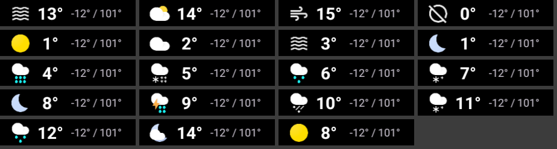

## Reminder segments

An optional setting cuts the outer ring into one segment per reminder, so 12 reminders give 12
segments. Turn it on in the watch face editor: long-press the face, tap the edit button, swipe to
**Other options** and switch on **Reminder segments**. It is off by default.

The face works the count out from the app's numbers: the daily goal over the interval target, rounded
up, so it follows your interval and plan without any setting of its own. It has room for 48 segments,
a whole day of half-hour reminders. 6, 12 and 24 have been tested on the emulators.

The ring is plain when there is no count to work out: outside the reminder window, while paused or on
a day off, or without the app. It is also plain once the daily goal is met, a solid ring in the goal
colour, because the app may then send a different target.

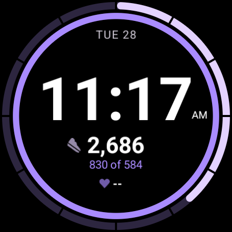 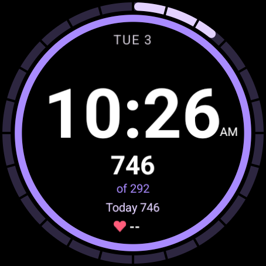

## Themes

Pick a theme in the watch face editor: long-press the face, tap the edit button, turn the crown. The
companion app shows the same themes as a row of flavors. A watch face can't read the app's settings,
so the face's theme and the app's theme are chosen separately.

**Parity rule:** these rows must match `AppTheme.kt` in the app exactly. If the app gains a theme,
the face gets the same row, in `ColorConfiguration` and in `Flavors` in
[watchface.xml](watchface/src/main/res/raw/watchface.xml).

| Theme | today | slot | goalMet | track |
|---|---|---|---|---|
| Violet (default) | `#E3D2FF` | `#A98BFF` | `#FFCC80` | `#2D2640` |
| Classic | `#D0BCFF` | `#4DD0E1` | `#FFCC80` | `#2E2A36` |
| Ocean | `#90CAF9` | `#2DD4BF` | `#FFE082` | `#1C2C36` |
| Forest | `#9CD6A0` | `#D4E157` | `#FFD54F` | `#22302A` |
| Sunset | `#FF9E80` | `#FFC44D` | `#FFF176` | `#36281F` |
| Rose | `#FFC2DC` | `#FF6FA8` | `#FFE082` | `#36252E` |
| Graphite | `#EEEEEE` | `#90A4AE` | `#FFD54F` | `#2A2C2E` |

## Build

JDK 17 or later and the Android SDK (platform 36) are needed. On this machine, Android Studio's JBR
works.

```bash
./gradlew check assembleDebug
```

`check` also runs `validateWatchFace`, which fails the build on invalid XML. It needs a clone of
[google/watchface](https://github.com/google/watchface) next to this repo, in
`../watchface-tools/watchface`, or wherever `-PwffToolsDir=...` points:

```bash
git clone https://github.com/google/watchface ../watchface-tools/watchface
```

With only the clone, `validateWatchFace` checks the XML against Google's v4 schema files using
[tools/WffSchemaCheck.java](tools/WffSchemaCheck.java). Once the official validator jar is built it
uses that instead. That jar and the memory footprint tool are Google's own builds, so run them before
a release:

```bash
cd ../watchface-tools/watchface/third_party/wff
./gradlew :specification:validator:executable-jar
```

```bash
cd ../watchface-tools/watchface/play-validations
./gradlew :memory-footprint:executable-jar
```

```bash
tools/validate.sh
```

`tools/validate.ps1` is the same thing for PowerShell. It checks the XML, then that the APK stays
under the Play limits of 10 MB always-on and 100 MB active.

`./gradlew :watchface:assembleRelease` makes a release APK. It is debug-signed, which is enough to
sideload; replace the `signingConfig` in [watchface/build.gradle.kts](watchface/build.gradle.kts)
before a Play upload.

## Install

Enable ADB debugging and wireless debugging on the watch, pair it, then:

```bash
adb install -r watchface/build/outputs/apk/debug/watchface-debug.apk
```

```bash
adb shell am broadcast -a com.google.android.wearable.app.DEBUG_SURFACE --es operation set-watchface --es watchFaceId com.hourlysteps.watchface
```

Or long-press the current face and pick **Hourly Steps**.

## Test on an emulator

Use the `system-images;android-36;android-wear-signed;x86_64` image with the Wear OS Small Round
(384 × 384) and Large Round (454 × 454) devices. Install the Hourly Steps debug APK with `adb install
-g` for live data; Health Services synthesises walking, so the rings fill within minutes. Force the
states from the app: **Settings > Pause reminders** for Paused, **Settings > Week** for Off, a low
**Daily goal** for goal met, and a clock jump past the last reminder for `--`:

```bash
adb shell cmd time_detector set_auto_detection_enabled false
```

```bash
adb shell cmd alarm set-time <epoch-milliseconds>
```

```bash
adb shell input keyevent KEYCODE_SLEEP
```

The last one shows the always-on face. The crown can be turned with `adb shell input rotaryencoder
scroll --axis SCROLL,-1`, and renderer errors show up here:

```bash
adb logcat --pid=$(adb shell pidof -s com.google.wear.watchface.runtime)
```

The emulators have no weather source and report a heart rate and step count of 0, so these only show live data
on a real watch. To test their layout, temporarily replace the `[WEATHER.*]` and `[HEART_RATE]`
sources in `watchface.xml` with fixed values, and put them back before committing.

Three things on the renderer that the XML schema doesn't catch:

- A `ColorConfiguration` with a single option fails to parse and every colour turns white.
- A `Condition` only redraws when the `Compare` it needs changes, so expressions that can both be
  true at once leave stale content. Keep them mutually exclusive.
- Text inside `Font` keeps its surrounding whitespace, which pushes it off centre.

Google's validator also exits 0 when a face is invalid, so `validateWatchFace` and `tools/validate.*`
read its output as well as its exit code.

## Limits

- The face can't tell how long an interval is, so it says "of 584", not "of 584 this hour".
- The system step counter is text only, so without the app the ring comes from `[STEP_PERCENT]`.
  That reads 0 on the emulators, so this ring still needs checking on a real watch with the app removed.
- Rings and text are vector. The only bitmaps are the preview, the flavor icons and the weather,
  heart and shoe icons.

## Credits

The weather icons are from Google's [Wear OS samples](https://github.com/android/wear-os-samples/tree/main/WatchFaceFormat/Weather),
under the Apache License 2.0 ([LICENSE-weather-icons.txt](LICENSE-weather-icons.txt)).

## Requests for the app

Not needed for this face to work, but they would improve it:

1. **Put the interval's wording in the title.** `RangedValueComplicationData` is built without a
   title, so the face builds "of 584" from the max. With `setTitle("of 584 this hour")` on the
   interval source the face could use the real wording for 30 min and 2 h intervals.
2. **Keep sending the interval target outside the reminder window.** The interval source sends 0 / 1
   then, so reminder segments disappear after the last reminder of the day. With the real target as
   the max and `--` as the text, the face could keep them showing all day. The face would also need a
   small change: it treats a max above 1 as active, and would have to check for `--` as well.

## Demo

Screenshots in [demo/](demo/) are from the two emulators. The theme and `large-active` shots use
sample weather, heart rate and step numbers. The others are live app states, so they have no weather
and show `--` for heart rate.

## Variant: Stack

A typographic take on the same data, in its own module, [watchface-stack/](watchface-stack/), with the
package `com.hourlysteps.watchface.stack` and the label **Hourly Steps Stack**. There are no rings. The
time is the picture, and the numbers read like a table beside it.

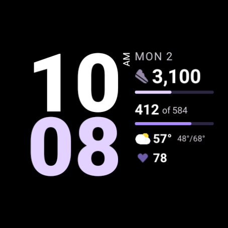 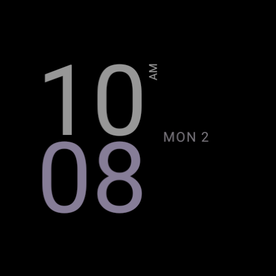

- **Time:** hours over minutes on the left, in the heaviest weight the system font has. Hours are white
  and minutes are in the theme's `today` colour. Both are right-aligned to the column, so a one digit
  hour leaves the space on the outer edge, and 12 hour mode has no leading zero, as on the main face.
- **AM/PM:** turned on its side in a narrow strip beside the hours, because there is no room beside them
  otherwise. 24 hour mode leaves the strip empty, so the column doesn't move.
- **Column,** left-aligned, top to bottom: date, today's steps with a thin bar, "412 of 584" with a thin
  bar in the `slot` colour, weather, heart rate. Numbers are bold and white, labels are smaller in
  `#CAC4D0`, and the only colour is in the bars and icons.
- **Goal met:** the total and its bar turn the goal colour, and "Goal met" appears as a last line.
- **Reminder segments:** the same option and count as the main face, but it cuts the today bar instead
  of a ring. A bar has two ends, so 12 reminders make 11 gaps. The gaps get thinner above 24 so the pieces
  stay visible: at 48 the bar reads as ticks.
- **Always-on:** the time in regular weight at 70 %, and the date, which moves down level with the gap
  in the time. The bars are hidden with everything else, unlike the main face's thin rings.
- **Tap a row** to open Hourly Steps. The today and interval rows are the two complication slots.

| App state | Today row | Interval row |
|---|---|---|
| Active | shoe, "3,100", bar | "412 of 584", bar |
| Past the interval target | as above | "1,940 of 584", full bar |
| Daily goal met | total and full bar in the goal colour, "Goal met" at the end of the column | "412 of 584", bar |
| Paused | "Paused", empty bar | empty bar |
| Day off | "Off", empty bar | empty bar |
| Outside the reminder window | shoe, total, bar | "--", empty bar |
| App not installed | shoe, "3050", bar from the watch's own step goal | "Add Hourly Steps", no bar |

The complication slots, the live `[STEP_COUNT]` numbers, the seven themes and flavors, and the renderer
gotchas are the same as above, and its expressions are copied from the main face. Nothing was dropped.
These differ from the main face:

- The heart rate row moves up into the weather row's place while the watch has no weather.
- The interval number is white, not the `slot` colour, so that the numbers read as one column.
- The preview and flavor icons are new screenshots of this design.

To build and install it, with the app installed first:

```bash
./gradlew :watchface-stack:check assembleDebug
```

```bash
adb install -r watchface-stack/build/outputs/apk/debug/watchface-stack-debug.apk
```

```bash
adb shell am broadcast -a com.google.android.wearable.app.DEBUG_SURFACE --es operation set-watchface --es watchFaceId com.hourlysteps.watchface.stack
```

Or long-press the current face and pick **Hourly Steps Stack**. `tools/validate.*` only look at the
main face, so run the same two Google jars on this module's XML and APK by hand.

Tested on the 384 and 454 emulators with Hourly Steps from `feature_uncapped_complications`, not yet on
a Pixel Watch 4. So the weight and width of the watch's own system font are unchecked, along with the
live count, which reads 0 on the emulators. On the emulators the time stays 23 units from the round edge
and a five digit total 14, so there is some room if the watch's digits come out wider.

Screenshots are in [demo/stack/](demo/stack/). `large-off`, `large-paused`, `small-paused`,
`large-outside-window` and `small-fallback-no-app` are live app states, so they have no weather and show
`--` for heart rate. The others use sample weather, heart rate and step numbers.

| | 454 | 384 |
|---|---|---|
| Goal met | 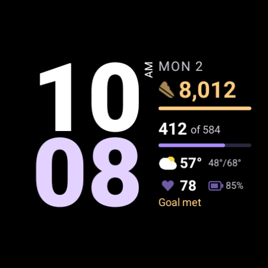 |  |
| Paused | 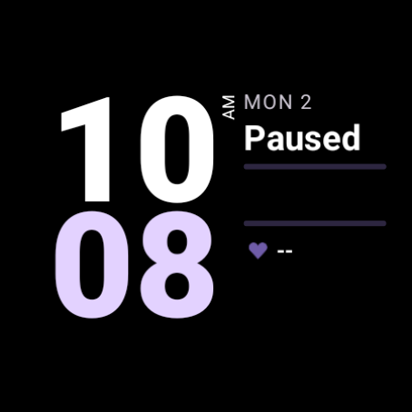 |  |
| 24 hour |  | 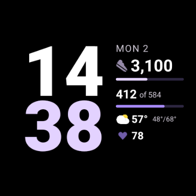 |
| Forest |  | 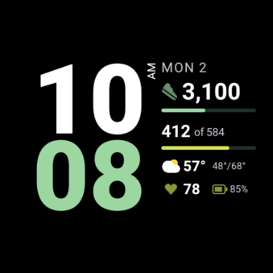 |
| Sunset |  | 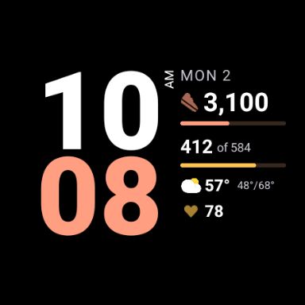 |
| Segments |  | 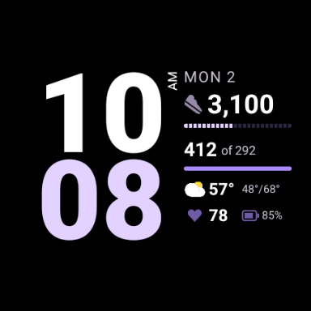 |
