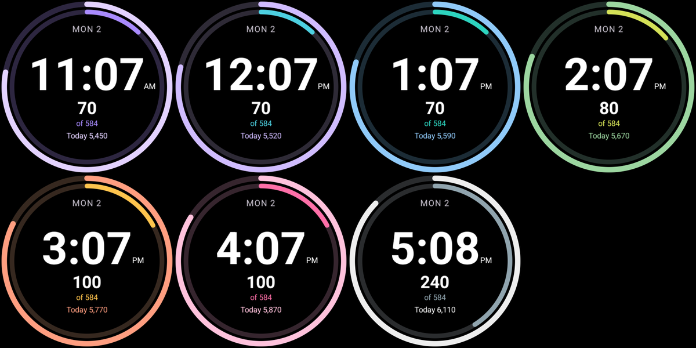

# Hourly Steps watch face

A watch face for the Pixel Watch 4 that puts the [Hourly Steps](#the-app) two-ring view around the
time, in the app's seven colour themes.

- **Outer ring:** today's steps against the daily goal. It turns the theme's goal colour once met.
- **Inner ring:** this interval's steps against its target.
- **Numbers:** the interval's steps, "of 584", and "Today 3,100" or "Goal met · 7,040".
- **Always-on:** thin dim rings, the date, and the time in regular weight at 70 %.
- **Tap a ring** to open Hourly Steps.



It is a [Watch Face Format](https://developer.android.com/training/wearables/wff) v4 face: only XML
and images, no code. One 450 × 450 design scales to both watch sizes (41 mm 408 × 408, 45 mm
456 × 456). It needs Wear OS 6 (API 36).

## The app

The face reads its numbers from the complications Hourly Steps publishes, so **install the app
before you add the face**. A face picks its data sources once, when it is added: added without the
app, it keeps the fallback below until you remove and re-add it, or pick the sources in its editor.

| App state | Rings | Text |
|---|---|---|
| Active | both fill | number, "of 584", "Today 3,100" |
| Daily goal met | outer ring full, in the goal colour | "Goal met · 7,040" |
| Paused | empty tracks | "Paused" |
| Day off | empty tracks | "Off" |
| Outside the reminder window | inner ring empty | "--", and today's line stays |
| App not installed | outer track from the watch's own step goal, inner ring hidden | "3,050 Steps", "Add Hourly Steps" |

The numbers update when the app sends them: at most once a minute while you walk and every 5 minutes
otherwise, the same as the app's tile.

## Themes

Pick a theme in the watch face editor: long-press the face, tap the edit button, turn the crown. The
companion app shows the same themes as a row of flavors. A watch face can't read the app's settings,
so the face's theme and the app's theme are chosen separately.

**Parity rule:** these rows must match `AppTheme.kt` in the app exactly. If the app gains a theme,
the face gets the same row, in `ColorConfiguration` and in `Flavors` in
[watchface.xml](watchface/src/main/res/raw/watchface.xml).

| Theme | today | slot | goalMet | track |
|---|---|---|---|---|
| Violet (default) | `#E3D2FF` | `#A98BFF` | `#FFCC80` | `#2D2640` |
| Classic | `#D0BCFF` | `#4DD0E1` | `#FFCC80` | `#2E2A36` |
| Ocean | `#90CAF9` | `#2DD4BF` | `#FFE082` | `#1C2C36` |
| Forest | `#9CD6A0` | `#D4E157` | `#FFD54F` | `#22302A` |
| Sunset | `#FF9E80` | `#FFC44D` | `#FFF176` | `#36281F` |
| Rose | `#FFC2DC` | `#FF6FA8` | `#FFE082` | `#36252E` |
| Graphite | `#EEEEEE` | `#90A4AE` | `#FFD54F` | `#2A2C2E` |

## Build

JDK 17 or later and the Android SDK (platform 36) are needed. On this machine, Android Studio's JBR
works.

```bash
./gradlew check assembleDebug
```

`check` also runs `validateWatchFace`, which fails the build on invalid XML. It needs a clone of
[google/watchface](https://github.com/google/watchface) next to this repo, in
`../watchface-tools/watchface`, or wherever `-PwffToolsDir=...` points:

```bash
git clone https://github.com/google/watchface ../watchface-tools/watchface
```

With only the clone, `validateWatchFace` checks the XML against Google's v4 schema files using
[tools/WffSchemaCheck.java](tools/WffSchemaCheck.java). Once the official validator jar is built it
uses that instead. That jar and the memory footprint tool are Google's own builds, so run them before
a release:

```bash
cd ../watchface-tools/watchface/third_party/wff
./gradlew :specification:validator:executable-jar
```

```bash
cd ../watchface-tools/watchface/play-validations
./gradlew :memory-footprint:executable-jar
```

```bash
tools/validate.sh
```

`tools/validate.ps1` is the same thing for PowerShell. It checks the XML, then that the APK stays
under the Play limits of 10 MB always-on and 100 MB active.

`./gradlew :watchface:assembleRelease` makes a release APK. It is debug-signed, which is enough to
sideload; replace the `signingConfig` in [watchface/build.gradle.kts](watchface/build.gradle.kts)
before a Play upload.

## Install

Enable ADB debugging and wireless debugging on the watch, pair it, then:

```bash
adb install -r watchface/build/outputs/apk/debug/watchface-debug.apk
```

```bash
adb shell am broadcast -a com.google.android.wearable.app.DEBUG_SURFACE --es operation set-watchface --es watchFaceId com.hourlysteps.watchface
```

Or long-press the current face and pick **Hourly Steps**.

## Test on an emulator

Use the `system-images;android-36;android-wear-signed;x86_64` image with the Wear OS Small Round
(384 × 384) and Large Round (454 × 454) devices. Install the Hourly Steps debug APK with `adb install
-g` for live data; Health Services synthesises walking, so the rings fill within minutes. Force the
states from the app: **Settings > Pause reminders** for Paused, **Settings > Week** for Off, a low
**Daily goal** for goal met, and a clock jump past the last reminder for `--`:

```bash
adb shell cmd time_detector set_auto_detection_enabled false
```

```bash
adb shell cmd alarm set-time <epoch-milliseconds>
```

```bash
adb shell input keyevent KEYCODE_SLEEP
```

The last one shows the always-on face. The crown can be turned with `adb shell input rotaryencoder
scroll --axis SCROLL,-1`, and renderer errors show up here:

```bash
adb logcat --pid=$(adb shell pidof -s com.google.wear.watchface.runtime)
```

Three things on the renderer that the XML schema doesn't catch:

- A `ColorConfiguration` with a single option fails to parse and every colour turns white.
- A `Condition` only redraws when the `Compare` it needs changes, so expressions that can both be
  true at once leave stale content. Keep them mutually exclusive.
- Text inside `Font` keeps its surrounding whitespace, which pushes it off centre.

## Limits

- The face can't tell how long an interval is, so it says "of 584", not "of 584 this hour".
- The system step counter is text only, so without the app the ring comes from `[STEP_PERCENT]`.
  That reads 0 on the emulators, so this one ring is only proven on a real watch.
- The always-on rings are dimmed by alpha, and text and rings are vector, so the only bitmaps are the
  preview and the flavor icons.

## Requests for the app

Not needed for this face to work, but they would improve it:

1. **Put the interval's wording in the title.** `RangedValueComplicationData` is built without a
   title, so the face builds "of 584" from the max. With `setTitle("of 584 this hour")` on the
   interval source the face could use the real wording for 30 min and 2 h intervals.

## Demo

Screenshots in [demo/](demo/) are from the two emulators.
